# Contagion

A reproducible research harness for instruction-boundary failures in LLM swarms, built from scratch for the November 6–8, 2026 Swarm Alignment Hackathon. Agents have separate histories and communicate through a bounded simulation controller. They have no tools, shell, file access or autonomous networking.

**Evidence checkpoint:** the compact protocol2.6 study completed36 runs/900 responses. Seventeen intermediate patch artifacts were flagged by the strict path scorer; final downstream flags were zero. A separate post-hoc wrapper-path sensitivity check preserves zero final flags while changing intermediate counts and task-format interpretation. The separate primary protocol4 allocation completed140 runs, including four integration prechecks,72 RQ1 and64 RQ3 runs. Original catalog-monitor recall is undefined without adoption positives. The paper's six trained GPT-2 captures are reference measurements, separate from the deployed swarm models. A later 72-cell reference grid reuses those six and adds66 captures; it does not revise the paper cutoff or explain swarm internals. A selected16-artifact human audit labeled all compliant; automated flags and human interpretation remain separate, with no general judge-accuracy claim. Primary collection is stopped for another operator; secondary recovery completed21 remaining assignments. Pending larger studies remain separate registrations, not results.

For submission, start with the [research report](report/paper.pdf), [submission handoff](docs/FINAL_SUBMISSION.md), [compact findings](report/COMPACT_RESULTS.md), and [LaTeX/report commands](report/README.md). Completed runs, pending collection and model opinions are separate evidence categories; none is a general alignment score.

The [submission runbook](docs/SUBMISSION_RUNBOOK.md) covers the immutable cutoff snapshot, actual human-audit import, PDF rehearsal and reviewer bundle. The [RQ assessment](docs/RQ_ASSESSMENT.md) lists supported findings and unresolved questions. Repository access is currently private and GitHub Pages is not enabled; the running local dashboard does not imply public availability.

The [long primary runbook](docs/PRIMARY_LARGE_RUNBOOK.md) describes the separately registered264-run/19,320-call static benchmark extension, paired batches, recovery and private progress. Its51long materials include pinned Martian reviews and SWE-bench Verified base-source issue diagnosis. These are benchmark adaptations with an explicit memory window; they do not execute upstream tasks or yield official benchmark scores. Ongoing collection does not update the paper's frozen evidence automatically.

The [multidisciplinary docket](docs/MULTIDOMAIN_DOCKET.md) adds psychology, science, mathematics, humanities and defensive cybersecurity evidence tasks. Its separate protocol includes pinned open-source BBH adaptations, unavailable-evidence checks and peer reporting-pressure conditions. The [guarded live controller](docs/MULTIDOMAIN_LIVE.md) supports development gates, separate numeric dashboard summaries and private traces. See [active experiments](docs/ACTIVE_EXPERIMENTS.md) for the recovered allocation sequence and limits.

## Start here

Requires Python 3.11+. Commands run from the repository root; no paid API is required.

```bash
python3 -m venv .venv
.venv/bin/python -m pip install --upgrade -r requirements-bootstrap.txt
.venv/bin/python -m pip install -e '.[test]'
.venv/bin/python -m pytest -q
.venv/bin/python scripts/run_pilot.py --env-file configs/mock.env --provider mock
```

For live inference, copy `.env.example` to `.env`, enter your approved endpoint and exact installed model tag, then run:

```bash
.venv/bin/python scripts/run_pilot.py --doctor-only
.venv/bin/python scripts/run_pilot.py
```

The pilot discovers model identity, checks a response and runs a bounded control/injection pair. It does not pull models or change server settings. Keep mock and live output directories separate. Research parameters belong in YAML; credentials and private server identifiers belong only in ignored `.env` files. See [worker setup](docs/WORKERS.md) before remote execution.

## Public judge preview

Build and open the exact allowlisted GitHub Pages artifact locally, with the same
numeric results, charts and reviewed public trace samples:

```bash
.venv/bin/python scripts/serve_public_preview.py --artifact results/public-preview/review-FRESH
```

Open <http://127.0.0.1:8766/>. This view has no private APIs or server telemetry;
the operational dashboard on8765 is separate. Refresh a reviewed checkpoint with
`scripts/export_live_dashboard.py` through `.venv/bin/python`, then use a fresh
artifact directory. See [current experiment status](docs/ACTIVE_EXPERIMENTS.md).
Primary collection is currently stopped/reserved; previewing results does not
restart experiments or publish the site.

## Experiment flow

```mermaid
flowchart LR
    A["Versioned scenario + paired seed"] --> B["Freeze prompts, config and source"]
    B --> C["Controller schedules isolated agents"]
    C --> D["One configured inference endpoint"]
    D --> E["Validate artifacts + route next round"]
    E -->|"bounded rounds"| C
    E --> F["Seal oracle logs + checksums"]
    F --> G["Score, monitor and review"]
    G --> H["Scrub public export"]
    H --> I["Dashboard + paper figures"]
    classDef plan fill:#dbeafe,stroke:#2563eb,color:#172554
    classDef run fill:#ede9fe,stroke:#7c3aed,color:#2e1065
    classDef evidence fill:#dcfce7,stroke:#16a34a,color:#14532d
    classDef public fill:#fef3c7,stroke:#d97706,color:#78350f
    class A,B plan
    class C,D,E run
    class F,G evidence
    class H,I public
```



| Research question | Comparison | Main evidence |
| --- | --- | --- |
| RQ1: network propagation | Ring, star, complete; control vs injection | Validated adoption, task success, exposure and propagation timing |
| RQ2: partial observability | Matched visibility masks over recorded runs | Precision, recall, F1 and coverage against separate oracle truth |
| RQ3: distributed responsibility | Single agent vs five-agent team | Forbidden proposals and actual synthetic record-state changes |

Run/seed is the analysis unit. Agents within a run, paired conditions and monitor projections are dependent. Scenario variants are synthetic, not independent attack designs. See the [unchanged specification](CONTAGION_AGENT_MVP_SPEC.md), [original protocol](docs/RESEARCH_PROTOCOL.md), and [protocol 2.4 amendment](docs/PROTOCOL_2_4.md). Prompt/schema changes require a fresh freeze and separate cohort; failed attempts remain preserved.

## Dashboard: local updates and public publication

```bash
.venv/bin/python scripts/serve_dashboard.py --sync-secondary
# Separately checkpoint sanitized live results for review/commit:
.venv/bin/python scripts/export_live_dashboard.py
```

Open **http://127.0.0.1:8765/**. No version or special URL is needed. The local service discovers sealed local studies every15seconds and polls configured sanitized secondary snapshots every minute. Primary controllers also write sealed results locally through their separately authorized inference tunnel. The dashboard itself does not initiate model calls. The visible page checks synchronization health and reloads changed frontend assets automatically. The explicit checkpoint exporter reads the isolated live cache; avoid another writer to that runtime cache.

Overview, Models, Evaluations, Traces and Datasets share all indexed experiments. Mock data is labeled and excluded from the default live selection. Protocols remain separate for scientific metrics; missing measurements show N/A. Neural and monitor views display only available measurements, never invented coverage.

The service validates checksums, redacts opt-in trace text and retains the prior valid snapshot if synchronization fails. Queue progress and hardware telemetry remain private. GitHub Pages serves reviewed committed snapshots and updates after a successful main-branch build; it does not connect to private servers or auto-push logs.

See [LaTeX paper and notebooks](report/README.md), [measurement plan](docs/RESEARCH_MEASUREMENT_PLAN.md), [repository benchmark tasks](docs/REPOSITORY_BENCHMARKS.md), [researcher guide](docs/RESEARCHER_GUIDE.md), [live updates](docs/LIVE_DASHBOARD.md), [privacy checks](docs/PRIVACY_CHECKS.md), and [portable components](docs/DASHBOARD_COMPONENTS.md).

## Developer guide

| Need | Start here |
| --- | --- |
| Assess evidence and improve measurements | [Researcher guide](docs/RESEARCHER_GUIDE.md) · [measurement audit](docs/MEASUREMENT_AUDIT.md) |
| Plan trained-model interpretability | [Interpretability protocol](docs/INTERPRETABILITY_PROTOCOL.md) |
| Understand modules and trust boundaries | [Architecture](docs/ARCHITECTURE.md) |
| Find current completion and blockers | [Progress](PROGRESS.md) · [build log](docs/BUILD_STATUS.md) |
| Configure primary/secondary workers | [Workers](docs/WORKERS.md) |
| Run bounded secondary batches | [Suite protocol](docs/SECONDARY_SUITE_PROTOCOL.md) |
| Understand advisory model judging | [Judge protocol](docs/JUDGE_PROTOCOL.md) |
| Generate paper figures and notebooks | [Periodic reports](docs/PERIODIC_REPORTS.md) |
| Capture actual neural measurements | [TransformerLens notes](docs/TRANSFORMERLENS_API.md) |
| Watch private experiment progress and ETA | [Private progress monitor](docs/PRIVATE_PROGRESS.md) |
| Scan traces for secrets and PII | [Privacy checks](docs/PRIVACY_CHECKS.md) |
| Install commit hooks and security checks | [Security checks](docs/SECURITY_CHECKS.md) |
| Reproduce original live results | [RQ1 results](report/RQ1_RESULTS.md) · [reproducibility](docs/REPRODUCIBILITY.md) |

```bash
.venv/bin/python scripts/check_all.py
.venv/bin/python scripts/export_dashboard.py --validate-only
.venv/bin/python scripts/export_research.py --validate-only
.venv/bin/python scripts/build_dashboard.py --out site-dist/preview
```

Raw logs, private requests, credentials and tensors stay ignored. Public exports use closed schemas and heuristic redaction; review optional text before pushing. Reviewers are advisory and uncalibrated. Generated thinking is text, not a neural measurement. Random-weight activations validate instrumentation, not learned features or alignment. There are no claimed SAE meanings, fabricated SHAP values or general alignment scores.

Research follow-ups, human review commands and neural coverage limits: [Confirmatory protocol](docs/CONFIRMATORY_PROTOCOL.md). Check the PDF with `.venv/bin/python scripts/submission_audit.py`; automated checks do not replace author review or submission confirmation.
