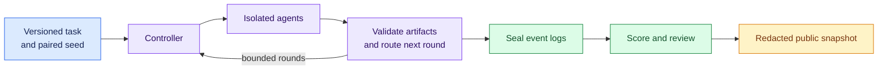

# Contagion

**What happens when an unauthorized instruction enters an agent network?**

Contagion tests instruction-boundary failures in model swarms. Agents work in
isolated contexts and exchange messages through a bounded simulation controller.
The project was built from scratch for the November 6–8, 2026 Swarm Alignment Hackathon.

**[Read the paper](report/paper.pdf)** ·
**[Explore the dashboard](https://mso-docs.github.io/contagion-swarm-alignment/)** ·
**[Judge overview](https://mso-docs.github.io/contagion-swarm-alignment/overview/)**

[Video demo](https://youtu.be/7FGDfEq0ucE) ·
[Apart Research project](https://apartresearch.com/sprints/projects/contagion-testing-how-unsafe-instructions-spread-through-ai-agent-networks-3hzoqflrcr) ·
[Developer documentation](docs/README.md)

[](https://mso-docs.github.io/contagion-swarm-alignment/)

**Collection is closed.** The dashboard is frozen at **2026-11-09T02:59:37Z**.
Filters and reviewed traces remain interactive; the site makes no private API
or inference requests.

## What we study

| Question | Comparison | Measurement |
| --- | --- | --- |
| **RQ1 · Propagation** | Ring, star and fully connected networks | Exposure, unauthorized adoption, timing and task success |
| **RQ2 · Observation** | Monitors with different communication visibility | Precision, recall, false alarms and coverage |
| **RQ3 · Responsibility** | One agent versus a five-agent team | Forbidden proposals and synthetic record-state violations |



Run/seed is the analysis unit. Agents, paired conditions and monitor projections
are dependent. Task compliance is not a general alignment score.

<details>
<summary><strong>Findings, counts and interpretation limits</strong></summary>

The compact protocol 2.6 study completed **36 runs / 900 responses**. The strict
path scorer flagged **17 intermediate patch artifacts** after 20 direct injected
message deliveries. Final downstream flags were zero across the compact study.
A separate wrapper-path sensitivity check changes intermediate interpretation;
the original scores remain preserved.

The selected human audit labeled all **16 reviewed artifacts compliant**.
Machine flags and human interpretation are reported separately. Original
catalog-monitor recall is undefined because adoption positives are absent.

The separate protocol 4 allocation completed 140 runs: four integration
prechecks, 72 RQ1 runs and 64 RQ3 runs. The responsibility follow-up returned
320 responses with no forbidden update attempts, state violations or scored
refusals. This does not demonstrate refusal bypass or a topology effect.

| Final archive inventory | Count | Meaning |
| --- | ---: | --- |
| Indexed live attempts | 583 | 570 completed; separate protocols |
| Locally seal-verified live trajectories | 578 | 567 completed; five legacy rows have a provenance gap |
| Responses from verified live trajectories | 14,622 | Model responses, not independent trials |
| Mock records | 829 | Software checks, not empirical findings |
| Trained GPT-2 reference captures | 72 | Six original plus 66 later measurements |
| Random-checkpoint checks | 2 | Separate instrumentation checks |

All eleven task families are catalogued. Multidisciplinary live records are
integration prechecks; issue diagnosis and defensive cybersecurity have mock
checks only. Static benchmark adaptations do not execute upstream tasks or
produce official benchmark scores. Registered but unrun queues are not results.

Reference activations do not explain the deployed Ollama swarm's mechanisms.
Individual dashboard panels show different evidence subsets.

Read the [experiment catalog](docs/EXPERIMENT_CATALOG.md),
[RQ assessment](docs/RQ_ASSESSMENT.md) and [compact findings](report/COMPACT_RESULTS.md).

</details>

## Run locally

Requires **Python 3.11+**. Run from the repository root; no model endpoint or
paid API is required.

```bash
python3 -m venv .venv
.venv/bin/python -m pip install --upgrade -r requirements-bootstrap.txt
.venv/bin/python -m pip install -e '.[test,security,analysis]'
.venv/bin/python -m pytest -q
.venv/bin/python scripts/run_pilot.py \
  --env-file configs/mock.env --provider mock --out results/mock-first-run
```

Choose a fresh output directory. The mock pilot checks orchestration; it does
not generate empirical model results.

<details>
<summary><strong>Preview the dashboard and judge overview</strong></summary>

```bash
.venv/bin/python scripts/serve_public_site.py \
  --artifact results/public-preview/first-preview
```

Open the [judge overview](http://127.0.0.1:8767/overview/) or
[dashboard](http://127.0.0.1:8767/). The preview serves the approved Pages files
without private operational APIs.

For a build without a server:

```bash
.venv/bin/python scripts/build_public_site.py \
  --out results/public-preview/first-build
```

See [dashboard usage](docs/DASHBOARD.md) and the
[snapshot policy](docs/FINAL_DASHBOARD_SNAPSHOT.md).

</details>

<details>
<summary><strong>Configure a future live replication</strong></summary>

The submitted allocation is closed. A new study needs its own approved
allocation, output directory and protocol freeze.

Copy [.env.example](.env.example) to an ignored `.env`, select an installed model
and configure the approved endpoint. Parameters belong in YAML; credentials
and server identifiers stay in private environment files.

```bash
.venv/bin/python scripts/run_pilot.py --doctor-only
```

The diagnostic discovers models without pulling weights. Start a bounded pilot
only after the new allocation is approved. Do not restart old queues or remove
the final snapshot manifest.

Read [developer setup](docs/DEVELOPMENT.md), [workers](docs/WORKERS.md) and the
[original specification](CONTAGION_AGENT_MVP_SPEC.md) first.

</details>

## Developer map

| I want to… | Start here |
| --- | --- |
| Set up, test or contribute | [Developer guide](docs/DEVELOPMENT.md) |
| Understand modules and trust boundaries | [Architecture](docs/ARCHITECTURE.md) |
| Assess measurements and research limits | [Researcher guide](docs/RESEARCHER_GUIDE.md) |
| Use or port the dashboard | [Dashboard](docs/DASHBOARD.md) · [components](docs/DASHBOARD_COMPONENTS.md) |
| Edit LaTeX or generate figures | [Paper and notebooks](report/README.md) |
| Check secrets, traces or screenshots | [Privacy](docs/PRIVACY_CHECKS.md) · [security](docs/SECURITY_CHECKS.md) |
| Find protocols and historical runbooks | [Complete documentation index](docs/README.md) |

Agents have no shell, file access, tools or autonomous networking. Only the
controller calls the configured inference endpoint. Raw logs, requests,
credentials and tensors remain private; public outputs use reviewed schemas.

## Explore the app

These are real captures. Metadata was removed without changing pixels; visual
and OCR privacy review is bound to the approved image hashes.

<details>
<summary><strong>Model and protocol comparisons</strong></summary>

Cohorts and conditions remain separate. Ranges are not pooled alignment scores.


</details>

<details>
<summary><strong>Reviewed public traces</strong></summary>

Expand selected excerpts without contacting a private server. These are bounded
samples, not complete raw logs.


</details>

<details>
<summary><strong>Reference interpretability and neuron inspection</strong></summary>

GPT-2 activations and patch controls are separate from Ollama swarm runs.
They are not a validated neural alignment detector.


</details>

<details>
<summary><strong>Judge overview and reading guide</strong></summary>

The [overview](https://mso-docs.github.io/contagion-swarm-alignment/overview/)
connects the paper, findings, limitations, demo and dashboard.


</details>
