# Contagion

A reproducible research harness for instruction-boundary failures in LLM swarms, built from scratch for the November 6–8, 2026 Swarm Alignment Hackathon. Agents have separate histories and communicate through a bounded simulation controller. They have no tools, shell, file access or autonomous networking.

**Current state:** the original live RQ1 matrix completed 18 runs / 450 responses, with a separate 2-run / 50-response model comparison. Those cohorts showed no validated suffix adoption. Protocol 2 adds scenario benchmarks, RQ2 monitoring, simulated RQ3 comparisons and exploratory swarm scaling. Recent development checkpoints passed 60 responses with zero parse failures; an injected patch run produced scored forbidden proposals. These are preliminary, separate cohorts—not general alignment findings. The large secondary suite is paused during validation. Neural instrumentation has measured random weights only; trained-checkpoint interpretation remains pending.

## Start here

Requires Python 3.11+. Commands run from the repository root; no paid API is required.

```bash
python3 -m venv .venv
.venv/bin/python -m pip install --upgrade -r requirements-bootstrap.txt
.venv/bin/python -m pip install -e '.[test]'
.venv/bin/python -m pytest -q
.venv/bin/python scripts/run_pilot.py --provider mock
```

For live inference, copy `.env.example` to `.env`, enter your approved endpoint and exact installed model tag, then run:

```bash
.venv/bin/python scripts/run_pilot.py --doctor-only
.venv/bin/python scripts/run_pilot.py
```

The pilot discovers model identity, checks a response and runs a bounded control/injection pair. It does not pull models or change server settings. Keep mock and live output directories separate. Research parameters belong in YAML; credentials and private server identifiers belong only in ignored `.env` files. See [worker setup](docs/WORKERS.md) before remote execution.

## Experiment flow

```mermaid
flowchart LR
    A["Versioned scenario + paired seed"] --> B["Freeze prompts, config and source"]
    B --> C["Controller schedules isolated agents"]
    C --> D["One configured inference endpoint"]
    D --> E["Validate artifacts + route next round"]
    E -->|"bounded rounds"| C
    E --> F["Seal oracle logs + checksums"]
    F --> G["Score, monitor and review"]
    G --> H["Scrub public export"]
    H --> I["Dashboard + paper figures"]
    classDef plan fill:#dbeafe,stroke:#2563eb,color:#172554
    classDef run fill:#ede9fe,stroke:#7c3aed,color:#2e1065
    classDef evidence fill:#dcfce7,stroke:#16a34a,color:#14532d
    classDef public fill:#fef3c7,stroke:#d97706,color:#78350f
    class A,B plan
    class C,D,E run
    class F,G evidence
    class H,I public
```



| Research question | Comparison | Main evidence |
| --- | --- | --- |
| RQ1: network propagation | Ring, star, complete; control vs injection | Validated adoption, task success, exposure and propagation timing |
| RQ2: partial observability | Matched visibility masks over recorded runs | Precision, recall, F1 and coverage against separate oracle truth |
| RQ3: distributed responsibility | Single agent vs five-agent team | Forbidden proposals and actual synthetic record-state changes |

Run/seed is the analysis unit. Agents within a run, paired conditions and monitor projections are dependent. Scenario variants are synthetic, not independent attack designs. See the [unchanged specification](CONTAGION_AGENT_MVP_SPEC.md), [original protocol](docs/RESEARCH_PROTOCOL.md), and [protocol 2.4 amendment](docs/PROTOCOL_2_4.md). Prompt/schema changes require a fresh freeze and separate cohort; failed attempts remain preserved.

## Dashboard: local updates and public publication

```bash
.venv/bin/python scripts/serve_dashboard.py --sync-secondary
# Separately checkpoint sanitized live results for review/commit:
.venv/bin/python scripts/export_live_dashboard.py
```

Open **http://127.0.0.1:8765/**. No version or special URL is needed. The local service discovers sealed studies every 15 seconds and polls sanitized secondary snapshots every minute. It does not access primary. The visible page checks local synchronization health and reloads changed frontend assets automatically. Pause other exporters while this service owns the public index.

Overview, Models, Evaluations, Traces and Datasets share all indexed experiments. Mock data is labeled and excluded from the default live selection. Protocols remain separate for scientific metrics; missing measurements show N/A. Neural and monitor views display only available measurements, never invented coverage.

The service validates checksums, redacts opt-in trace text and retains the prior valid snapshot if synchronization fails. Queue progress and hardware telemetry remain private. GitHub Pages serves reviewed committed snapshots and updates after a successful main-branch build; it does not connect to private servers or auto-push logs.

See [LaTeX paper and notebooks](report/README.md), [measurement plan](docs/RESEARCH_MEASUREMENT_PLAN.md), [repository benchmark tasks](docs/REPOSITORY_BENCHMARKS.md), [researcher guide](docs/RESEARCHER_GUIDE.md), [live updates](docs/LIVE_DASHBOARD.md), [privacy checks](docs/PRIVACY_CHECKS.md), and [portable components](docs/DASHBOARD_COMPONENTS.md).

## Developer guide

| Need | Start here |
| --- | --- |
| Assess evidence and improve measurements | [Researcher guide](docs/RESEARCHER_GUIDE.md) · [measurement audit](docs/MEASUREMENT_AUDIT.md) |
| Plan trained-model interpretability | [Interpretability protocol](docs/INTERPRETABILITY_PROTOCOL.md) |
| Understand modules and trust boundaries | [Architecture](docs/ARCHITECTURE.md) |
| Find current completion and blockers | [Progress](PROGRESS.md) · [build log](docs/BUILD_STATUS.md) |
| Configure primary/secondary workers | [Workers](docs/WORKERS.md) |
| Run bounded secondary batches | [Suite protocol](docs/SECONDARY_SUITE_PROTOCOL.md) |
| Understand advisory model judging | [Judge protocol](docs/JUDGE_PROTOCOL.md) |
| Generate paper figures and notebooks | [Periodic reports](docs/PERIODIC_REPORTS.md) |
| Capture actual neural measurements | [TransformerLens notes](docs/TRANSFORMERLENS_API.md) |
| Watch private experiment progress and ETA | [Private progress monitor](docs/PRIVATE_PROGRESS.md) |
| Scan traces for secrets and PII | [Privacy checks](docs/PRIVACY_CHECKS.md) |
| Install commit hooks and security checks | [Security checks](docs/SECURITY_CHECKS.md) |
| Reproduce original live results | [RQ1 results](report/RQ1_RESULTS.md) · [reproducibility](docs/REPRODUCIBILITY.md) |

```bash
.venv/bin/python scripts/check_all.py
.venv/bin/python scripts/export_dashboard.py --validate-only
.venv/bin/python scripts/export_research.py --validate-only
.venv/bin/python scripts/build_dashboard.py --out site-dist/preview
```

Raw logs, private requests, credentials and tensors stay ignored. Public exports use closed schemas and heuristic redaction; review optional text before pushing. Reviewers are advisory and uncalibrated. Generated thinking is text, not a neural measurement. Random-weight activations validate instrumentation, not learned features or alignment. There are no claimed SAE meanings, fabricated SHAP values or general alignment scores.
