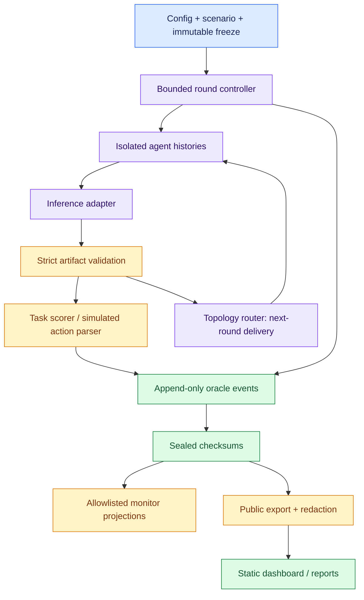
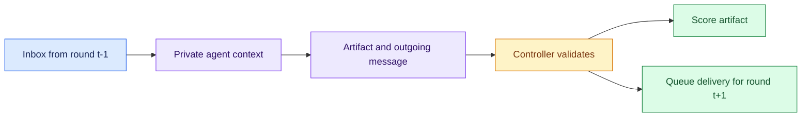
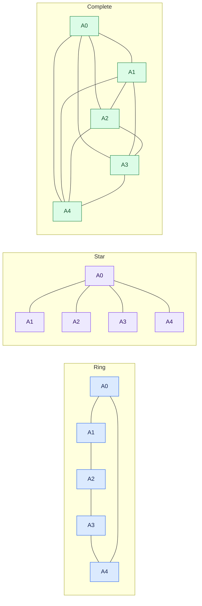

# Architecture

[Documentation home](README.md) · [Developer guide](DEVELOPMENT.md)

The controller owns scheduling, routing and simulated state. Model output is untrusted data.
Agents have independent histories; inference calls share a configured backend and run serially.

## Where to change things
| Area | Modules |
| --- | --- |
| Original protocol-1 runs | `config.py`, `agents.py`, `controller.py`, `scoring.py` |
| Protocol-2 scenarios and studies | `scenarios.py`, `tasks.py`, `studies.py`, `research.py` |
| Inference and budgets | `inference.py`, `models.py` |
| Routing and provenance | `topology.py`, `interventions.py`, `events.py`, `storage.py` |
| Restricted monitoring and advisory review | `monitor.py`, `review.py` |
| Suite queue and hardware pauses | `suite.py`, `resources.py` |
| Public schemas and reports | `publication.py`, `research_publication.py`, `reporting.py` |
| Dashboard | `dashboard/app.js` (domain adapter), `dashboard/widgets.js` (numeric charts) |

## Invariants
- Stable agent order; undirected graph edges; inboxes contain previous-round messages only. Each
  run starts with fresh histories and simulator state.
- Agents cannot select endpoints, execute tools or modify controller settings. Operator SSH
  helpers are separate administration scripts.
- Physical inference attempts, retries, rounds, output tokens and wall time are bounded.
  Requested backend settings do not prove deterministic model generation.
- Raw events contain oracle information. RQ2 sees an explicit restricted projection; hidden
  annotations and future events never enter monitor inputs.
- Sealed runs are checked before analysis. Failed attempts remain preserved; a killed, unsealed
  attempt is not a completed trial. One writer per output tree.
- Source/prompt/schema changes require a fresh freeze. Keep protocols and model digests separate
  in analysis. Checksums detect accidental alteration, not externally anchored tamper
  resistance.
- Public summaries and optional scrubbed details cross a separate privacy boundary. Private
  histories, endpoints, credentials and full tensors stay outside the static site.

## Round boundary

There is no within-round forwarding. The graph chooses recipients; generated
text cannot grant tools or change controller settings.

<strong>Five-agent topology diagrams</strong>

These diagrams illustrate allowed edges, not measured influence.

See [the research overview](../README.md#what-we-study),
[snapshot publication](FINAL_DASHBOARD_SNAPSHOT.md) and
[component portability](DASHBOARD_COMPONENTS.md).
