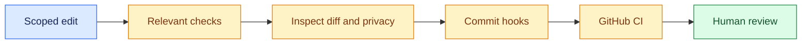

# Developer guide

[Documentation home](README.md) · [Architecture](ARCHITECTURE.md) · [Security](SECURITY_CHECKS.md)

Set up a clone, make a scoped change and verify it locally. The submitted
experiment is closed; ordinary development needs no server access.

## Set up once

```bash
python3 -m venv .venv
.venv/bin/python -m pip install --upgrade -r requirements-bootstrap.txt
.venv/bin/python -m pip install -e '.[test,security,analysis]'
.venv/bin/python scripts/setup_security.py
```

Hook setup needs network access the first time. Keep `.venv` installed for
subsequent commits. No paid inference is required.

## Choose the smallest useful check

| Change | Check |
| --- | --- |
| Controller, scorer or inference adapter | Relevant pytest tests, then the full suite and a mock pilot |
| Publication, trace or image handling | Privacy tests, `scripts/check_all.py`, and a fresh public build |
| Dashboard behavior | Python checks, `node tests/dashboard_runtime.js`, and browser review |
| Documentation | Local links, Mermaid rendering, command paths and security hooks |
| Paper analysis | Frozen-input checks, regenerated figures, PDF audit and author review |



<details>
<summary><strong>Test and mock-pilot commands</strong></summary>

```bash
.venv/bin/python -m pytest -q
.venv/bin/python scripts/run_pilot.py \
  --env-file configs/mock.env --provider mock --out results/development-mock
.venv/bin/python scripts/check_all.py
```

Choose a fresh output directory. Raw attempts remain in ignored `results/`.
A deterministic mock verifies orchestration rather than real-model behavior.
Loopback HTTP tests need permission to bind a local port.

The JavaScript check needs Node.js and also runs in CI. Do not report it as
passed when Node is unavailable locally.

</details>

## Find the right code

| Responsibility | Location |
| --- | --- |
| Python package and CLI | `src/contagion/` |
| Research orchestration | `research.py`, `studies.py` in the package |
| Configuration | `configs/`, `.env.example` |
| Operator and analysis entry points | `scripts/` |
| Frozen dashboard | `dashboard/` |
| Judge overview | `site/overview/` |
| LaTeX and frozen numerical inputs | `report/` |
| Tests and synthetic fixtures | `tests/` |

<details>
<summary><strong>Environment configuration and future live work</strong></summary>

Copy `.env.example` to an ignored `.env` only for an approved live replication.
Set `CONTAGION_PROVIDER`, `CONTAGION_BASE_URL` and the exact installed
`CONTAGION_MODEL`. The example lists supported optional settings.

Keep credentials and worker identities out of YAML, issues and screenshots.
Environment files are parsed as data, not sourced as shell code.

```bash
.venv/bin/python scripts/run_pilot.py --doctor-only
```

The diagnostic is not permission to resume submitted queues. Future studies
need a separate allocation, fresh state and frozen prompts/scorers. Preserve
the STOP markers and `dashboard/data/submission-freeze.json`.

</details>

## Writing developer documentation

Lead with the page's purpose and next useful command. Keep current status
visible. Collapse long command catalogs, historical runs and implementation
notes with `<details>`, leaving blank lines around Markdown content.

Use Mermaid for architecture, screenshots for actual UI, and recorded-data
plots for results. Label illustrative diagrams and retain measurement limits.
The [documentation index](README.md) separates current guides from protocols
and historical runbooks.
