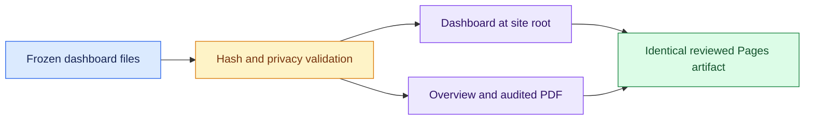

# Final dashboard snapshot




[Documentation home](README.md) · [Developer guide](DEVELOPMENT.md)


The submission dashboard is a fixed, reviewed checkpoint. Its graphs, filters and selected trace
drilldowns work locally and on GitHub Pages using the same allowlisted files. Opening the public
dashboard never probes private APIs or starts a collector. A frozen artifact does not poll or
refresh; its banner identifies the collection cutoff and content SHA256.

The final inventory includes six separate result sources, development/evaluation labels,
incomplete attempts and mock records. Trained-checkpoint captures, random-weight checks, monitor
cells and advisory reviews have separate denominators. These counts supplement the paper's
original study cutoffs; they do not pool dependent observations or imply every task has a
mechanistic measurement. Only seven specifically reviewed trace samples and the previously
approved public detail files contain bounded text. Raw logs remain private.

## Prepare the final artifact
<details>
<summary><strong>Expand reference and commands</strong></summary>

After stopping collection and reconciling `report/data/final_inventory.json`, the operator runs:

```sh
.venv/bin/python scripts/freeze_dashboard.py --inventory report/data/final_inventory.json --cutoff <UTC-cutoff> --confirm-quiescent
.venv/bin/python scripts/serve_public_preview.py --artifact results/public-preview/submission-final --build-only
.venv/bin/python scripts/serve_public_preview.py --artifact results/public-preview/submission-final --serve-existing --port 8766
```

Use an explicit UTC timestamp such as `2026-11-09T01:00:00Z` only when it is the actual, past
collection cutoff. The freeze refuses a mismatched inventory or an existing manifest. Builds
verify every approved asset hash and refuse stale nonempty output directories. The live-data
exporter refuses to overwrite frozen data. Any later study needs a separate checkpoint and
review; do not edit or remove the final manifest to bypass this boundary.

Open [the exact public preview](http://127.0.0.1:8766/). It has no operational APIs. Both
current local ports 8765 and 8766 serve the exact final artifact. The collector service refuses
startup while the submission manifest exists; the frozen client also overrides any operator
parameter. Do not replace another operator's running preview process without coordinating its
restart.

The manifest is `dashboard/data/submission-freeze.json` (`public-dashboard-freeze-1.0`). It
binds the exact inventory bytes, four numeric indexes, all approved text companions and
application assets. Its content digest excludes the manifest itself; a separate digest binds the
manifest fields. This detects accidental changes within the validated artifact, rather than
promising external authentication or perfect anonymity. Building and previewing do not deploy,
change repository visibility or submit the hackathon entry.

</details>
