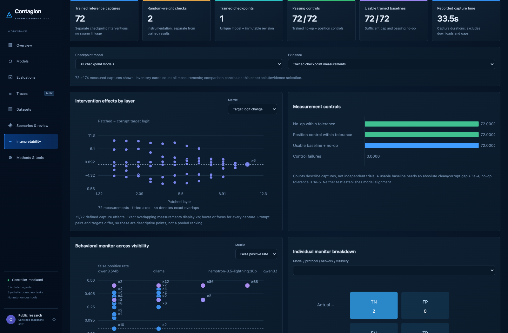

# Interpretability: evidence ladder

[Documentation home](README.md) · [Developer guide](DEVELOPMENT.md)

**Final evidence:** 72 trained GPT-2 reference captures and two separate
random-checkpoint checks. The trained grid includes six original measurements
and 66 later captures. These are reference instrumentation studies, not recordings
of the deployed Ollama models.

The earlier development plan is preserved below. Its statements about what had
not yet run describe that earlier checkpoint, not the final inventory.



## Read the measurements correctly

- Compare clean, corrupt, patched, no-op and position-control forwards.
- Normalized restoration is undefined for tiny baseline gaps or failed controls.
- A target logit is not a probability; top-K selected neurons are not all neurons.
- Named SAE features, calibrated neural alignment detection and a matched swarm
  mechanism have not been established.

See [expanded reference measurements](EXPANDED_NEURAL_REFERENCE.md) and the
[final catalog](EXPERIMENT_CATALOG.md) for completed evidence.

```mermaid
flowchart LR
    R["Random checks"] --> C["Trained reference captures"]
    C --> Q["Parity and intervention controls"]
    Q --> E["Reference-only conclusions"]
    E -. "future separate study" .-> M["Matched swarm checkpoint and behavior"]
    M -.-> H["Held-out causal validation"]
    classDef blue fill:#dbeafe,stroke:#2563eb,color:#172554
    classDef purple fill:#ede9fe,stroke:#7c3aed,color:#2e1065
    classDef green fill:#dcfce7,stroke:#15803d,color:#14532d
    classDef amber fill:#fef3c7,stroke:#d97706,color:#78350f
    class R blue
    class C,Q,E green
    class M,H amber
```



<details>
<summary><strong>Original development protocol and proposed next studies</strong></summary>

The current capture is a working instrumentation baseline. It is not yet a strong mechanistic
study of the swarm models.

```mermaid
flowchart LR
    A["Random-weight smoke"] --> B["Pinned trained checkpoint + logit parity"]
    B --> C["Predeclared clean/corrupt task pairs"]
    C --> D["Layer/position interventions + controls"]
    D --> E["Held-out replication + behavioral link"]
    E --> F["Optional matched SAE feature study"]
    classDef done fill:#dcfce7,stroke:#15803d,color:#14532d
    classDef next fill:#dbeafe,stroke:#2563eb,color:#172554
    classDef later fill:#ede9fe,stroke:#7c3aed,color:#2e1065
    class A done
    class B,C next
    class D,E,F later
```



## What is measured now

Two-layer random GPT-2 captures provide residual RMS, selected MLP neuron values and a
clean-to-corrupt residual patch with no-op and position controls. The upgraded secondary CPU
smoke passed original-model/TransformerLens logit parity (maximum absolute difference about
6e-8). Checkpoint mode now requires an immutable revision, explicit token alignment and a
predeclared single-token target. `--patch-layer` selects the intervention layer. No trained
checkpoint or named SAE feature has been measured.

The dashboard and reports show baseline logit gap, patch delta, no-op error and normalized restoration:

`(patched − corrupt) / (clean − corrupt)`

Restoration is undefined when the baseline gap is below 1e-4 or the no-op error exceeds 1e-5.
Values outside [0,1] are retained. A non-negligible position-control effect is a warning, not
evidence of alignment. A target logit is not a probability. Selected neurons are biased toward
high clean activation; their distribution is not the distribution of all neurons or SAE
features.

## Next bounded trained-checkpoint pilot

1. Start with a small supported trained checkpoint as an engineering positive control. The
   verified [GPT-2 model card](https://huggingface.co/openai-community/gpt2) provides a
   Transformers/safetensors checkpoint. Revision `607a30d783dfa663caf39e06633721c8d4cfcd7e` was
   verified against the model API. This is a reference model, not a replacement for the
   Qwen/Ollama study.
2. Cache the approved checkpoint on the existing secondary CPU worker. Keep remote code disabled
   and use safetensors. Do not download larger models, tune shared Ollama or touch primary as
   part of this pilot.
3. Predeclare clean/corrupt synthetic prompt pairs, the intervention token spans, target token,
   layers and controls. Inspect tokenizer positions before assigning alignments. Keep
   task-related pairs separate from a known capability positive control.
4. Verify raw/bridge parity, repeated baseline stability and no-op controls. Reject invalid
   shapes, missing hooks, unstable baselines and token truncation. Preserve every attempt.
5. Run selected layers/positions on multiple development pairs, then freeze the analysis and
   replicate on held-out pairs. Report every planned intervention; do not select only the
   largest effects.
6. For claims about a swarm model, instrument its compatible checkpoint and record
   tokenizer/revision/dtype/quantization differences. A replay is still not a recording of the
   opaque Ollama execution.

The existing CLI can perform a single frozen intervention on a cached model:

```bash
.venv-interp/bin/python scripts/capture_neural.py --mode checkpoint \
  --model openai-community/gpt2 \
  --revision 607a30d783dfa663caf39e06633721c8d4cfcd7e \
  --clean-file results/interp/clean.txt --corrupt-file results/interp/corrupt.txt \
  --alignment CLEAN_POSITION CORRUPT_POSITION --target-token ' TARGET' \
  --patch-layer LAYER --out results/interp/unique-attempt
```

Replace the uppercase position/target/layer placeholders after tokenizer inspection. This
command is a recipe; no trained run or download is claimed. Missing cached weights fail closed
unless an operator explicitly chooses `--allow-download`.

## Better figures and metrics

| Figure | Required evidence | Interpretation |
| --- | --- | --- |
| Layer × token residual RMS | Measured activations | Magnitudes; no semantic label |
| Target-logit controls | Clean/corrupt/patched/no-op/control forwards | Local effect of the chosen intervention |
| Layer × aligned-position patch grid | Complete predeclared intervention sweep | Candidate locations with uncertainty across prompt pairs |
| Target-versus-foil logit margin | Two predeclared alternatives and measured logits | Preferred next study metric; not yet captured by current single-target schema |
| Token/feature examples | Exact tokenizer alignment and held-out examples | Descriptive selectivity; scrub text before publication |
| SAE feature views | Matching trained SAE, layer/hook and model revision | Requires reconstruction loss, sparsity/dead-feature checks and causal validation |

TransformerLens supports measured patch grids and per-example analysis: [patching
API](https://transformerlensorg.github.io/TransformerLens/generated/code/transformer_lens.patching.html),
[analysis
tools](https://transformerlensorg.github.io/TransformerLens/content/analysis_tools.html).
Neuronpedia-style named feature views require an actual compatible
[SAE](https://docs.neuronpedia.org/sparse-autoencoders/overview);
[SAELens](https://decoderesearch.github.io/SAELens/api/) supplies SAE evaluation tooling.
Neither package supplies trustworthy alignment labels automatically.

</details>
