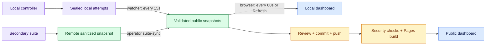

# Keep the dashboard current

## Recommended: one automatic local service

```bash
.venv/bin/python scripts/serve_dashboard.py --sync-secondary
```

Open **http://127.0.0.1:8765/**. This serves only allowlisted public assets on loopback, discovers sealed local studies every 15 seconds, and optionally fetches sanitized secondary snapshots every minute into ignored staging before merging them atomically. No primary access, inference, Git push or Pages deployment occurs. Do not run another exporter or static server on the same port/output concurrently.

The main overview and model/evaluation/trace/dataset views share legacy and newer indexed runs. The old 20-run total is only one historical cohort. Mock evidence remains separate; unrecorded metrics show N/A. Asset changes trigger local reload and responses prevent caching. A local status line reports synchronization health; blocked updates retain the previous valid projection. Unsealed active attempts wait for their checksum seal; use the private progress tool for in-flight work.

Public GitHub Pages remains a reviewed, push-triggered snapshot. An unavailable secondary or its slower export cadence can delay remote results; the local status reports synchronization failure. The service does not promise instantaneous or offline remote updates.

The manual workflows below remain useful for troubleshooting while the automatic service is stopped.


The dashboard reads static, sanitized files. It never contacts Ollama or SSH. A fresh browser fetch cannot discover private runs until an exporter publishes them.



## Local study results

Run one watcher for the public output. Do not run it concurrently with remote `suite-sync` or another exporter writing the same snapshot.

```bash
.venv/bin/python scripts/watch_dashboard.py --study results/studies --interval 15
```

Use repeated `--study PATH` arguments to select narrower sources. Only protocol-2 attempts with manifests, config snapshots and checksum seals are considered. Integrity failures block that update and retain the previous public index. Existing approved study rows, monitor results, neural captures and suite telemetry are preserved; rows with the same run ID are refreshed. Operational suite status and hardware telemetry are private; use the [terminal progress monitor](PRIVATE_PROGRESS.md). The public page shows collected research evidence only. Unchanged data does not advance the export timestamp.

Summary-only export is the default. Add `--include-text` for bounded, scrubbed task and response details. This does not publish full request histories or raw logs. Review text before committing; pattern scrubbing cannot guarantee anonymity. An interrupted watcher can be restarted; Ctrl-C stops only the exporter.

For one update:

```bash
.venv/bin/python scripts/watch_dashboard.py --study results/studies --once
.venv/bin/python scripts/export_research.py --validate-only
```

## Remote suite results

The detached secondary worker publishes its own sanitized snapshots periodically. Fetch them explicitly when the local watcher is stopped:

```bash
.venv/bin/python scripts/remote_worker.py suite-status --server secondary
.venv/bin/python scripts/remote_worker.py suite-sync --server secondary
```

Synchronization replaces the research snapshot with the remote version. Restarting the local watcher merges selected local studies back into that snapshot. These commands do not access primary. The large suite remains paused until checkpoint validation is complete; syncing does not resume inference.

## Which count am I seeing?

| View | File | Meaning |
| --- | --- | --- |
| Legacy source for unified views | `data/results.json` | Original RQ1 export; merged with newer studies by the frontend |
| Scenarios & review, Neural captures | `data/research.json` | Newer studies, reviews, monitors, measurements and suite telemetry |
| Clicked benchmark row | `data/studies/<id>.json` | Bounded task and trace detail, if exported |

The research view shows export time, last browser check and run-attempt count. Refresh reloads both snapshots. A visible tab polls every 60 seconds. Hard-refresh after JavaScript changes. An old export timestamp means no newly exported evidence; an old browser-check time suggests the tab is inactive or refreshing failed.

## Public Pages

Review and push the sanitized snapshot and referenced detail files. Pages updates after the main-branch security/build workflow succeeds. It does not stream from private servers, and a running local watcher does not push or deploy anything.

If results look stale: check the correct view, verify the attempt is sealed, inspect exporter output, validate the snapshot, then check the latest Pages build. Never copy private raw results into the website to bypass an export failure.
