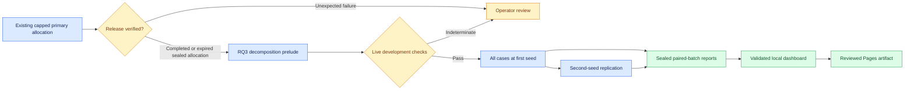

# Long primary benchmark allocation

The current primary protocol3.3 study keeps its original eight-hour cap. A separate administrative release watcher checks actual completion or a verified expired, sealed prefix; it never relabels a partial study complete. The new protocol3.4 allocation follows a separately registered50-run/186-call RQ3 decomposition prelude and the shared primary lease.



| Item | Registered scope |
|---|---|
| Materials |51long cases,14canonical projects,11domains;42held-out cases available |
| Selected evaluation |32cases:3fresh Martian reviews and29SWE-bench Verified issue diagnoses |
| Agents and turns |5private contexts,15rounds; synchronous ring routing |
| Arms |Plain/source-attributed peer notes × clean/injected |
| First stage |8development runs/120calls; every selected task kind covered |
| Coverage |128runs/9,600calls; every case at the first paired seed |
| Replication |128runs/9,600calls at the second seed, after coverage finishes |
| Total |264runs/19,320scheduled calls;21,252physical-call ceiling |
| Execution |72cumulative hours;96-hour wait ceiling; no hidden inference retries |
| Batches |16evaluation runs, four complete matched case blocks |

These are static benchmark adaptations: no repository tools, upstream execution or official benchmark scores. SWE contexts use explicitly disclosed reference-localized base windows. A case is not necessarily solvable from the displayed excerpt. Source and task kind co-vary, so their effects cannot be causally separated. The three Martian cases cannot support broad source-specific generalization.

Long activity retains the original task, two own previous rounds and current peer deliveries. Omitted history is logged. A later disappearance of flags can reflect memory eviction or phase instructions; it does not demonstrate learned correction or safety. Semantic task correctness remains unknown until independent reference adjudication. Source-location feasibility is a weak operational check, not a correctness score.

## Active registration and private monitoring

The current registration is `results/campaigns/primary-large-v34-20261108-r2`. Its predecessor is `primary-decomposition-v41-release-20261108`, whose prerequisite is the administrative release watcher under `results/checkpoint-gates/primary-release-v1-20261108`. Earlier zero-call registrations remain preserved with supersession records. Older interrupted mocks are engineering attempts, not completed validation or model evidence.

```bash
.venv/bin/python scripts/experiment_progress.py \
  --campaign results/campaigns/primary-large-v34-20261108-r2 --watch
```

The local dashboard shows private progress at <http://127.0.0.1:8765/>. In-flight call counts are provisional; unsealed outcomes enter research views only after validation. Research defaults to live inference; select mock evidence explicitly to inspect engineering fixtures. Summary export caches unchanged sealed rows and invalidates on seal/file-stat/redaction-policy changes, avoiding repeated parsing of long request histories. This is not an externally anchored tamper-proof log.

Offline reports are registered at `results/reports/primary-large-v34-20261108-r2-final`. Each completed batch produces paired descriptive analysis, PDF/SVG/PNG coverage/boundary/runtime plots, and a separate partial-visibility monitor report. After verified release, the observer also preserves a descriptive report of complete four-arm blocks from the prior allocation; it does not promote that study to completed. The dashboard consumes only closed numeric summaries and bounded redacted local trace views. Source text, hidden references, private projections and operator telemetry remain private.

## Recovery and stopping

Structured-output, context, source, seal, disk and thermal failures stop later calls. The queue records an allowlisted failure code and an opaque failed-attempt identifier; provider exception text is not logged as a diagnostic. Inspect the stopped state and sealed attempt before deciding on recovery.

```bash
# Only after the operator reviews the failure and resolves its cause:
.venv/bin/python scripts/large_primary_queue.py run \
  --root results/campaigns/primary-large-v34-20261108-r2 \
  --provider ollama --env-file .env.primary --resume --retry-failed
```

An explicit retry writes a hash-bound decision receipt. Failed and uncertain attempts retain their call/time reservations and original bytes. A later successful matching job can resolve a reviewed failure, but never erases it. Assignment, routing, reference isolation and seal failures remain blocking. A root `STOP` file stops before another call; it does not modify or restart the remote inference service.

## Submission cutoff and final review

At10seconds per call, the large schedule alone is approximately54hours, excluding the predecessor, cooling and overhead. This is an estimate, not a promised finish time. Some collection will likely outlast the global hackathon cutoff. The paper uses a declared evidence freeze; later data must be labeled separately. Descriptive completed-batch analysis is available at an explicit cutoff and does not imply the registered full study is complete.

After code/data review and validation, prepare a fresh packet:

```bash
.venv/bin/python scripts/prepare_review_packet.py \
  --out results/final-review-FRESH \
  --classic results/paper-classic-final \
  --template results/paper-template-final \
  --artifact site-dist/publication-final-FRESH
```

The packet requires a clean committed tree and checks both PDF variants against the same scientific source. It includes the exact source archive without Git history/ignored private files, the allowlisted Pages preview and the offline research bundle. It never changes repository visibility, deploys Pages, merges code, approves authorship declarations or submits to the hackathon. Final scientific/visual author review and actual submission remain operator actions.
