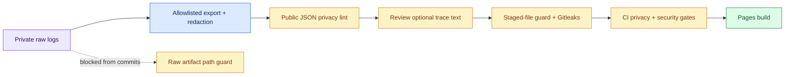

# Privacy checks before publication

Raw research logs stay unchanged and ignored. Public exports are separate, scrubbed copies. Commit hooks inspect actual staged bytes, so a clean working copy cannot conceal unsafe staged content. GitHub Actions repeats the checks before Pages deployment.



## Run it

```bash
# Quick read-only audit of current public data; no network or model calls.
.venv/bin/python scripts/scan_privacy.py

# Full tracked + untracked, nonignored candidate checks, including Gitleaks.
.venv/bin/python scripts/check_all.py

# Optional strict audit of a private batch. Does not edit its records.
.venv/bin/python scripts/scan_privacy.py --path results/studies/your-batch
```

The scanner prints file counts and finding categories, never matched content. Any finding or scan error exits nonzero. The commit guard also names the candidate file unless its path contains a known private value. Raw audits can flag intentionally synthetic examples; keep those records private rather than changing scientific evidence to pass a publication scan.

## What blocks publication

| Check | Scope |
| --- | --- |
| Gitleaks | Staged secrets; full candidate and Git-history scans in manual/CI checks |
| Known private values | Local environment, every repository-root `.env*` variant except `.env.example`, private denylist strings |
| PII lint | Non-example emails, recognizable phones, government-ID patterns and Luhn-valid payment-card candidates in candidate text |
| Strict public JSON lint | All emails, credential patterns, private-key headers, IPv4 addresses, home paths and recognizable PII; JSON escapes decoded first |
| Artifact guard | `.env`, raw result/log/trace directories, JSONL outside the designated mock fixture, `.log`, databases, tensors, HAR captures and common raw trace JSON filenames |
| Closed-schema validation | Only approved public fields; no arbitrary request metadata or private histories |
| Build validation | Referenced public JSON is linted again before any artifact files are copied |

Reserved example-domain email addresses are permitted in source/docs but still blocked in public JSON. Tests are not globally exempt. Scanners are read-only and fail closed; they do not silently remove findings or repair staged files.

## Names, identifiers and extra strings

Create an ignored repository-root file named `private.redact.txt`, with one private name, address fragment or other exact identifier per line. Comments beginning with `#` are ignored. Prefer specific strings of at least three characters. Do not add this file to Git.

The guard loads these strings and private dotenv values locally. The research exporter and watcher use the same private context when redacting new exports. Re-export an affected snapshot, then rerun the checks. Existing public rows preserved during a merge are checked too; unsafe existing content blocks publication rather than being silently trusted.

For the legacy exporter, `--redact-file private.redact.txt` also supplies explicit extra redaction strings. `.env` files are parsed as data, never executed; no credentials or trace text are sent to a scanning service.

## Limits

### Reviewed README screenshots

Only the PNG files listed in `docs/images/screenshots.json` may bypass the
text-only binary rejection. Each image must match its reviewed SHA-256 and
dimensions. PNG parsing checks CRCs, bounded decoded pixel size, row filters and
end-of-file; text, EXIF, XMP and unexpected metadata chunks are rejected.

Capture the public static preview, keep operator screens and browser chrome out
of frame, and inspect both visible text and local OCR output before approving a
new hash. Strip metadata without changing pixels. Never edit displayed metrics
to improve a screenshot. Update the manifest only after review, then run
`.venv/bin/python scripts/check_all.py`. OCR transcripts remain ignored/private.

CI verifies the approval hash and PNG structure; it does not independently
repeat the visual/OCR review or prove that pixels contain no private information.

Pattern checks cannot identify every personal name, postal address, encoded secret, image or sensitive fact. False positives are possible. Summary-only exports minimize exposure; opt-in traces still need review. A clean scan means no recognized pattern or configured private string was found, not proof of anonymity. If sensitive content already reached Git history, removing it from the latest snapshot is insufficient; rotate exposed credentials and assess history cleanup separately.
