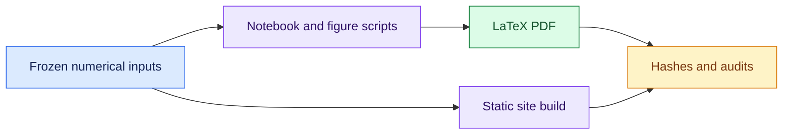

# Reproducibility checklist

[Documentation home](README.md) · [Developer guide](DEVELOPMENT.md)

Start with offline reproduction of the committed evidence. This does not
require model calls, worker access or a paid API.

| Goal | Entry point |
| --- | --- |
| Inspect the report | [Canonical PDF](../report/paper.pdf) |
| Rebuild figures and LaTeX | `make report` from the repository root |
| Build the reviewed public site | `scripts/build_public_site.py --out results/public-preview/reproduce` |
| Exercise orchestration | [Developer mock pilot](DEVELOPMENT.md) |
| Reconstruct study scope | [Experiment catalog](EXPERIMENT_CATALOG.md) |

Raw authoritative logs remain private. Public numeric freezes and selected
reviewed excerpts are separate artifacts; they do not expose every raw event.
Five legacy live rows have an explicit provenance gap. Checksums verify bytes,
not scientific interpretation.

<strong>Original reproducibility checklist and remaining review limits</strong>

- [x] New source and task authored in this repository; no imported project implementation.
- [x] Configuration snapshots, protocol/source hashes, seed schedules and undirected graph edges.
- [x] Raw invocation/response traces, independent contexts, original/delivered intervention text.
- [x] Deterministic mock, ordered scheduler and reproducibility tests (excluding timing).
- [x] Exclusive attempts, completed-only resume, checksums, explicit failure/budget statuses.
- [x] Offline metrics/figures regenerated from raw events; manual artifact review export.
- [x] Python dependencies declared; local exact-version snapshot in requirements.lock.txt.
- [x] Operator configures endpoint and selects installed model tag/digest.
- [x] Successful logged live smoke request and output parsing.
- [x] One live paired pilot inspected; protocol/scorer frozen before batch.
- [x] Live 18-condition RQ1 matrix and failure accounting.
- [ ] Hardware details recorded by operator (manifest records controller OS/architecture only).
- [x] RQ2 implementation/leakage tests; separate RQ3 development simulator comparison.
- [x] Separately frozen 64-run responsibility follow-up; selected 16-artifact human audit
  retained separately from machine scores.
- [ ] Independent human calibration with positive examples, semantic-quality labels and
  inter-rater agreement.
- [x] Verified primary-source bibliography, reconstructed official layout, compiled research PDF
  and appendices.
- [ ] Final human side-by-side template and scientific review.
- [ ] Sanitized empirical data reviewed before publication.

Follow README commands. The small included mock fixture under tests/fixtures/mock_run can be
analyzed without inference. Raw generated results are git-ignored; allowlisted sanitized
snapshots and the final report are separate publication artifacts. Do not merge mock/live
sources. A checksum verifies bytes, not the truth of a scientific claim. Live pilot/batch
availability is recorded in BUILD_STATUS.md; the included fixture remains mock-only. Later
dashboard data do not revise the frozen paper automatically.

