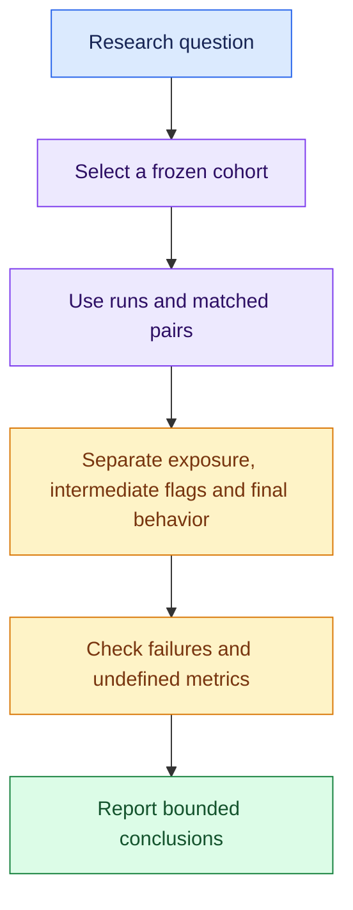

# Researcher guide

[Documentation home](README.md) · [Experiment catalog](EXPERIMENT_CATALOG.md) · [Paper](../report/paper.pdf)

Use this guide to distinguish what was measured, what each count means and
which conclusions remain unsupported. The submitted evidence is frozen.

## Choose the evidence for your question

| Question | Start with | Interpretation |
| --- | --- | --- |
| Did unauthorized behavior persist? | Compact protocol 2.6 results | Intermediate flags and final adoption are different endpoints |
| Does topology cause different outcomes? | Paired conditions and message exposure | The compact sample does not establish a topology effect |
| Can a partial monitor detect adoption? | Catalog visibility projections | Recall/F1 are undefined without positives |
| Does a team violate the record boundary? | Separate 64-run RQ3 follow-up | Zero observed attempts/state violations/refusals; limited cases and seeds |
| What do activations explain? | GPT-2 reference captures and controls | Instrumentation evidence, not an Ollama swarm mechanism |
| How broad is the archive? | Final inventory and task catalog | Coverage across protocols, not a pooled evaluation sample |



## Final inventory

The archive has **583 indexed live attempts** and **829 mock records**.
Of the live attempts, 578 have locally verified source seals, including
567 completed trajectories and 14,622 returned responses. Five older rows have
an explicit provenance gap. These are coverage counts across separate cohorts.

The 72 trained GPT-2 reference captures and two random checks have their own
denominators. They are not additional swarm trials.

See [EXPERIMENT_CATALOG.md](EXPERIMENT_CATALOG.md) for all eleven task families,
completed/failed attempts, models, protocols, and mock-only task coverage.

<details>
<summary><strong>Analysis rules and common mistakes</strong></summary>

- Use runs as units. Nested agents, paired conditions and repeated visibility
  projections are dependent.
- Keep model digest, worker, source freeze, protocol, task, split, executor and
  swarm size separate. A grand total does not define a held-out sample.
- Preserve failed/exhausted attempts, malformed outputs and unscorable cases.
  A completed controller run can still contain invalid task artifacts.
- Match clean/injected results by case and seed. Do not choose the most
  favorable retry from ambiguous duplicate candidates.
- Separate exact-path/format scoring from semantic quality. Human disagreement
  with a machine flag must remain visible rather than silently repaired.
- Binomial working-model intervals do not account for template dependence.
  Sparse paired estimates do not receive an automatic significance claim.
- Do not substitute marker mention for adoption, runtime reduction for deliberate
  cheating, or generated reasoning text for measured activations.

</details>

## Reproduce without inference

```bash
.venv/bin/python scripts/research_report.py --out results/research-review
make report
```

Choose fresh output directories. The generic report describes available public
snapshots; the LaTeX paper uses its own frozen evidence inputs. Rebuilding one
does not silently expand the other's scientific sample.

<details>
<summary><strong>Reports, neural evidence and future improvements</strong></summary>

The reporter writes run/cohort tables, paired effects, neural quality metrics,
figures, captions and source hashes. Tables retain every cohort; figure caps
and omitted counts are explicit. Generated artifacts stay in ignored `results/`.

For stronger future experiments, prioritize independent task cases, repeated
seeds, matched-delivery controls and held-out judge calibration before increasing
swarm size. Reference checkpoint studies need a matched behavioral link before
supporting claims about the deployed swarm model.

- [Measurement audit](MEASUREMENT_AUDIT.md)
- [Measurement plan](RESEARCH_MEASUREMENT_PLAN.md)
- [Interpretability protocol and final status](INTERPRETABILITY_PROTOCOL.md)
- [Reporting workflow](PERIODIC_REPORTS.md)
- [Reproducibility](REPRODUCIBILITY.md)

</details>
