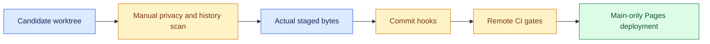

# Commit, CI and publication checks

[Documentation home](README.md) · [Developer guide](DEVELOPMENT.md)


For trace scanning, PII rules and private denylist setup, see [Privacy checks](PRIVACY_CHECKS.md).

Local hooks and GitHub Actions protect commits and publication. Review candidate files, optional
trace text and Git author identity before pushing. The setup helper installs hooks; it does not
stage, commit or push files.

## Install on a fresh clone
<details>
<summary><strong>Implementation details and reference</strong></summary>

```bash
python3 -m venv .venv
.venv/bin/python -m pip install --upgrade -r requirements-bootstrap.txt
.venv/bin/python -m pip install -r requirements-security.txt -e '.[test]'
.venv/bin/python scripts/setup_security.py
.venv/bin/python scripts/check_all.py
```

The setup installs .git/hooks/pre-commit using standard pre-commit and downloads SHA-pinned hook
environments. Gitleaks builds in an isolated Go environment; pre-commit bootstraps Go if
unavailable. First setup needs network access; routine commits use the installed cached tools.
This repository uses .venv/bin/python for local checks, so keep that environment installed. Tool
caches are not public artifacts. The setup helper selects certifi's verified CA bundle when
SSL_CERT_FILE is unset; it never disables TLS verification.

After edits, run `scripts/check_all.py` before the first commit. Unlike `pre-commit run
--all-files` in a mostly untracked repository, this helper passes **tracked and untracked,
nonignored candidate files** to manual hooks. It does not stage files. Normal commit hooks scan
the staged index. Pre-commit hides unstaged edits during ordinary staged execution, and the
custom guard independently reads actual index blobs so a clean unstaged copy cannot hide unsafe
staged data.

</details>

## Local checks


<details>
<summary><strong>Implementation details and reference</strong></summary>

- SHA-pinned Gitleaks with default rules and fully redacted output. Normal commits scan staged
  changes. Manual preflight scans a temporary copy of candidate files and all Git history. No
  test, fixture or public-trace folder is globally excluded, and inline gitleaks:allow bypass
  comments are ignored.
- Publication guard blocks .env variants, private credentials/keys, raw results/JSONL, denylist
  files, unapproved dashboard data, symlinks/submodules and files above 5 MiB. Only the small
  designated mock JSONL fixture is permitted. Ignoring files is supplemented by index checks,
  including forcibly staged files.
- Known local credential values and configured private endpoint/hostname are checked without
  echoing their values. Public snapshot schema/redaction is validated against the actual staged
  JSON. Arbitrary unknown PII or encoded secrets are not guaranteed detectable.
- Merge-conflict, JSON/YAML/TOML syntax, private-key and large-file checks.
- Read-only Ruff checks for critical syntax/undefined-name errors and Bandit
  medium/high-severity, medium/high-confidence Python findings. Low-severity informational
  findings are not asserted to be absent.

No formatter/autofixer runs on source events, fixture files or snapshots. Scanner failures block
commits instead of silently skipping tools. Tests that need a fake PEM marker assemble it at
runtime; private-key detection is not weakened to accommodate those tests.

Git author names/emails are separate Git metadata, not trace redaction inputs. Review your
author identity before a public push; use your GitHub noreply address if desired. Changing the
current identity does not remove metadata from existing commits. No identity settings or history
were modified automatically.

</details>

## Dependency checks
Direct development/security tools are version-pinned in requirements-security.txt. The existing
requirements.lock.txt records exact runtime versions but is not a hash-locked cross-platform
dependency lock. pip-audit runs in CI because advisory queries require network access; no model
traces or .env values are uploaded, only package identities/versions. It audits both the
recorded runtime pins and the installed environment, skipping the editable local project
(covered by source tests/static analysis). Do not suppress a newly found vulnerability merely to
publish.

```bash
.venv/bin/python -m pip_audit --disable-pip --no-deps -r requirements.lock.txt --cache-dir .cache/pip-audit --progress-spinner off
.venv/bin/python -m pip_audit --local --skip-editable --cache-dir .cache/pip-audit --progress-spinner off
```

Initial audit found vulnerabilities in the old local pip 26.1.1; pip was updated to 26.3 and the
bootstrap version is pinned. No runtime lock package was changed and no vulnerability ignore
list was added.

## GitHub Actions and Pages
`.github/workflows/pages.yml` runs on pull requests, main pushes, manual dispatch and a weekly
schedule. It checks full history, candidate secrets/private files, syntax/security, dependency
advisories, pytest, dashboard interactions and the allowlisted static build. Actions and
external hook repositories are pinned to verified commit SHAs, with release labels in comments.
Checkout fetches full history and does not persist Git credentials.

Only successful main push/manual runs upload and deploy the Pages artifact. Pull requests and
scheduled audits never deploy. The deploy job depends on the checks and alone receives
pages:write/id-token:write. There is no pull_request_target workflow or paid scanner action. The
build copies allowlisted frontend assets, validated public snapshots and referenced study-detail
shards; private raw files are excluded. No GitHub job contacts a model endpoint or runs live
inference.

Dependabot checks pip and GitHub Actions weekly. For enforcement, configure GitHub branch
protection/rulesets to require **Security and reproducibility gates**, and enable available
secret-scanning/push-protection controls. These remote repository settings were not changed
here. Local hooks can be deliberately bypassed; remote CI plus required checks is the second
boundary, and public Git history must still be reviewed before pushing.

## Verification and first commit
A disposable-repository probe confirmed a generated nonfunctional staged API-key-shaped value is
rejected by Gitleaks and absent from scanner output. Security tests cover actual staged blobs,
forced private files, valid/dangling symlinks, snapshot validation and known-value error
redaction. The real repository index was not changed for these tests.

After all checks pass and you review the public snapshot:

```bash
.venv/bin/python scripts/check_all.py
git status --short
git add .
git commit -m "feat: add bounded swarm experiments, observability and security gates"
```

The commit triggers staged checks automatically. Investigate failures rather than using
--no-verify or SKIP. No automated scanner proves the absence of every secret or PII item; future
opt-in trace exports still need review and sampled audits.
