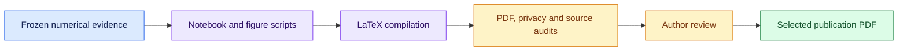

# Paper and analysis workflow

[Documentation home](../docs/README.md) · [Canonical PDF](paper.pdf) · [Final inventory](data/final_inventory.json)

Edit LaTeX, rebuild offline, then review the resulting PDF. These commands use
recorded evidence and make no model calls.

## Edit and render

From the repository root:

```bash
make report
open results/paper-local/paper.pdf
```

Edit `report/paper.tex` and rerun `make report` after saving. `open` is the macOS
viewer command; on another OS, open the same output in your PDF viewer.

The local build is separate from `report/paper.pdf`. Review and audit a new build
before replacing the committed publication artifact.



## Pick the right notebook

| Task | Source | Scope |
| --- | --- | --- |
| Reproduce selected paper figures | `notebooks/paper_figures.ipynb` | Frozen paper inputs |
| Explore task coverage | `notebooks/all_tasks_analysis.ipynb` | Broader inventory; separate from paper claims |
| Review candidate figures | `notebooks/report_workbench.ipynb` | Interactive analysis and selection |

<details>
<summary><strong>Execute the all-task notebook</strong></summary>

```bash
.venv/bin/python scripts/execute_notebook.py \
  --source notebooks/all_tasks_analysis.ipynb \
  --out results/reports/all-tasks.executed.ipynb
```

Choose an appropriate new output. Keep generated notebooks and local review
outputs under ignored `results/` until selected and privacy-reviewed.

</details>

<details>
<summary><strong>Compiler options and dependency setup</strong></summary>

```bash
.venv/bin/python -m pip install -e '.[analysis]'
make report-check
make report REPORT_TYPEFACE=template REPORT_OUT=results/paper-template-local
```

Latin Modern Roman remains the default. The template variant uses its recorded
typeface settings. Each variant compiles from the same scientific source and
records its source, PDF and embedded-font hashes.

The project-local Tectonic compiler is cached under `.cache/report-tools/`.
Use `scripts/build_paper.py --help` for compiler and output options. First-time
dependency/compiler/font setup may need network access; model inference is not
part of the report build.

</details>

## Figure and reporting rules

Give each figure one measured comparison. Show denominators and sample sizes;
retain undefined metrics, missing data and negative results. Distinguish
intermediate flags from final behavior and reference captures from swarm runs.

The validated canonical report has seven main-text pages, sixteen total pages
and a 211-word abstract. Read the [measurement guide](../docs/RESEARCHER_GUIDE.md)
and [periodic report workflow](../docs/PERIODIC_REPORTS.md) before expanding claims.

<details>
<summary><strong>Earlier build recipes, scientific cutoffs and submission preparation</strong></summary>

These notes preserve the earlier preparation record. Statements about private
repository access, unenabled Pages or a draft PR describe that earlier stage;
the repository and Pages are now public.


The paper is authored in `paper.tex` and exported to an actual PDF. Author: **Mackenzie O'Brien
— Independent AI Researcher, Mac Labs AI**.

## Edit and rebuild

Edit `report/paper.tex`, save it, then run from the repository root:

```bash
make report
open results/paper-local/paper.pdf  # macOS; reopen or refresh after rebuilding
```

This regenerates the notebook figures, builds with Latin Modern Roman and checks
the resulting PDF. Rerun `make report` after each edit. It uses existing recorded
evidence and makes no model calls. The local output is separate from the committed
submission PDF at `report/paper.pdf`; replace that publication artifact only after
checking the new build.

Use `make report REPORT_TYPEFACE=template REPORT_OUT=results/paper-template-local`
for the official template's Arial variant, or `make report-check` to check an
existing local build. If dependencies are missing, install `.[analysis]` as below.

The official public DOCX template was inspected: US Letter, one-inch margins,11-point Arial
body, Old Standard TT title and recommended section structure. The adaptation and template hash
are recorded in `template_format.json`. Main text must be at most8pages, excluding
references/appendices; abstract150–250words; limitations/dual-use appendix required. See the
[official guidelines](https://apartresearch.com/sprints/swarm-alignment-2026).

Current validated report: **7main-text pages,16total pages,211abstract words**; the author
reviews the exact PDF before submission. The paper's compact checkpoint distinguishes strict
any-round flags from final adoption. A separate post-hoc sensitivity audit checks
wrapper-prefixed paths; original scores remain unchanged. The selected16-artifact human audit
labeled all compliant, and its differences from automated flags are reported separately. New
overnight runs are not silently pooled into the compact analysis.

```bash
.venv/bin/python -m pip install -e '.[analysis]'
.venv/bin/python scripts/build_paper.py
```

The project-local Tectonic compiler is under ignored `.cache/report-tools/tectonic`; another
installed Tectonic binary can be selected with `--compiler`. At the author's request, **Latin
Modern Roman** remains the default body/title typeface. Use `--typeface classic` explicitly for
that variant or `--typeface template` for Arial body and Old Standard title typefaces. Both
compile from the same authored source and numerical freezes; only the compiled copy's two font
declarations change. Typeface and build details remain here and in metadata rather than the
manuscript. Use separate output directories. The build records the authoring-source hash,
compiled-source hash, selected variant, PDF hash and actual embedded font names; the audit
verifies their consistency. The template build reuses the cached Old Standard font and license
when available. It executes the notebook through a private local IPC kernel and never performs
model inference. Compiler cache/font metadata and the compiled build manifest remain in ignored
local outputs.

```bash
.venv/bin/python scripts/build_paper.py --typeface classic --out results/paper-classic-final
.venv/bin/python scripts/build_paper.py --typeface template --out results/paper-template-final
.venv/bin/python scripts/submission_audit.py --paper-dir results/paper-template-final
```

Outputs:

- `results/paper-draft/paper.pdf`: compiled research draft.
- `results/paper-draft/paper_figures.executed.ipynb`: executed review notebook with diagrams and
  explanations.
- `results/paper-draft/figures/`: candidate PDF/SVG/PNG figures, numerical tables and provenance
  manifest.
- `results/paper-draft/build_manifest.json`: PDF hash, page counts, abstract length and
  privacy/content checks.

The editable source notebook is `notebooks/paper_figures.ipynb`; frozen numerical evidence is
`data/compact_evidence.json`. Figures01,02,07 are selected for the main text; topology,
monitoring, reference patching, timing and path sensitivity remain appendix diagnostics.
Selection emphasizes legibility and scientific interpretation, including null results, rather
than effect size.

The separate `notebooks/all_tasks_analysis.ipynb` visualizes all currently indexed live tasks
without changing paper claims:

```bash
.venv/bin/python scripts/execute_notebook.py \
  --source notebooks/all_tasks_analysis.ipynb \
  --out results/reports/all-tasks.executed.ipynb
```

Future checkpoints should create a fresh evidence freeze, regenerate candidate figures and
revise narrative claims before replacing selected figures. `build_paper.py` rejects data that no
longer match the current compact narrative. PDF/source/figures require author review before
submission. The implementation PR stays draft and is not automatically merged.


Figure conventions: emphasize one measured comparison per panel; print sample sizes and count
denominators; distinguish intermediate from final deviations; use fixed 0–1 color scales for
rate heatmaps. Fit continuous measurement axes with padding, disclose transformed axes, and
label overlapping points. Keep independent protocols and reference neural captures
distinguishable. Presentation updates must not change the frozen evidence.

The completed protocol4 RQ3 follow-up is separately frozen in
data/rq3_followup.json:64runs,320responses,four fixed cases and one seed. Its paragraph is
separate from the compact36-run RQ1 analysis and excludes four integration prechecks. The helper
verifies every source seal and the complete registered matrix. No refusal-bypass conclusion is
supported because no scored refusals occurred.

[Research readiness](RESEARCH_READINESS.md) maps the six remaining goals to evidence and manual
checks. The private offline review workspace requires actual human clicks. The research bundle
packages allowlisted source, numerical freezes, figures, dependencies and PDF, and regenerates
frozen figures from a source-only temporary copy without inference.

Supplemental public numeric freezes are `data/patch_pointer_audit.json`,
`data/human_audit.json`, and the three files under `data/submission_snapshot/`. The build
validates these inputs, generates the appendix from their counts and binds their code/data
hashes. Individual human labels, reasons and correction history remain private. The snapshot
contains403 supported completed runs at2026-11-08T06:57:00Z:329Ollama and74mock, separated by
cohort; it is an inventory, not403independent experimental trials.

Use [the final submission runbook](../docs/SUBMISSION_RUNBOOK.md) and [read-only
rehearsal](../docs/SUBMISSION_REHEARSAL.md). Repository access is restricted and Pages is not
enabled. Neither a local PDF nor a successful rehearsal confirms public availability or actual
submission.

</details>
